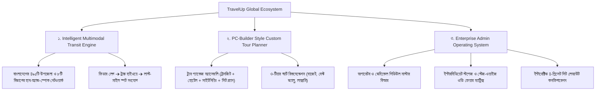

# 🚀 TravelUp Global — প্রজেক্ট মাস্টার হ্যান্ডওভার ও রোডম্যাপ গাইড (A to Z)

> **ডকুমেন্ট তৈরি করার তারিখ**: ২২ অক্টোবর ২০২৬  
> **প্রজেক্ট স্ট্যাটাস**: ট্রানজিট ও ট্যুর প্ল্যানার ফুল ইন্টিগ্রেশন সম্পন্ন (পজ / হোল্ড স্টেট)  
> **কো-অথর অ্যাট্রিবিউশন**: `Md. Toufick Hasan <337840059+toufick-hasan@users.noreply.github.com>`

---

## ১. ওয়েব অ্যাপ্লিকেশনের মূল উদ্দেশ্য ও ভিশন (Core Purpose & Vision)

### ১.১ সমস্যা যা আমরা সমাধান করছি (The Problem)
বাংলাদেশের ভ্রমণ ও পর্যটন খাত অত্যন্ত বিচ্ছিন্ন (Fragmented):
1. **বিচ্ছিন্ন টিকিট ব্যবস্থা**: বাসের জন্য এক ওয়েবসাইট (Shohoz/BusBD), ট্রেনের জন্য রেলওয়ের সাইট, অভ্যন্তরীণ ফ্লাইটের জন্য এয়ারলাইন্স, আর হোটেল বা রিসোর্টের জন্য আলাদা ব্যবস্থা।
2. **রিমোট ট্যুরিস্ট স্পটে যাতায়াতের সংযোগহীনতা**: মূল শহর থেকে প্রত্যন্ত ট্যুরিস্ট স্পটগুলোতে (যেমন: সাজেক ভ্যালি, সেন্টমার্টিন, টাঙ্গুয়ার হাওড়, নাফাখুম, কাপ্তাই, কুয়াকাটা) যাওয়ার জন্য সরাসরি কোনো পাবলিক ট্রান্সপোর্ট নেই। যাত্রীকে একাধিক ধাপে লোকাল বাস, সিএনজি, ট্রাঙ্ক কোচ, চান্দের গাড়ি কিংবা ট্রলারে পরিবর্তন (Transfer) করতে হয়—যার কোনো সমন্বিত টিকিট বা রোডম্যাপ পাওয়া যায় না।
3. **প্যাকেজ কাস্টমাইজেশনের অভাব**: সাধারণ ট্রাভেল এজেন্সিগুলো ফিক্সড গ্রুপ ট্যুর দেয়, যেখানে বাজেট অনুযায়ী নিজের পছন্দমতো বাস, হোটেল বা অ্যাক্টিভিটি বাছাই করার স্বাধীনতা থাকে না।

### ১.২ ট্রাভেলআপ গ্লোবালের ভিশন (The Solution: TravelUp Global)
**TravelUp Global** হলো বাংলাদেশের প্রথম **অল-ইন-ওয়ান মাল্টিমোডাল ট্রানজিট ও ইন্টেলিজেন্ট ট্যুর প্ল্যানিং প্ল্যাটফর্ম**। এর মূল স্তম্ভ ৩টি:



---

## ২. এখন পর্যন্ত কী কী সম্পন্ন করা হয়েছে (A to Z Completed Work)

### ক. ব্যাকএন্ড ও জিও-ডেটাবেজ আর্কিটেকচার (Backend & DB)
1. **Node.js & Express REST API Server** (`server/server.js`):
   - পোর্ট `5000`-এ এক্সপ্রেস সার্ভার চলমান।
   - MySQL কানেকশন পুলিং (`server/config/db.js`) এবং সিকিউর রাউটিং।
2. **বাংলাদেশের সম্পূর্ণ জিও-লোকেশন ডেটাবেজ** (`server/controllers/tourPlannerController.js`):
   - **৮টি বিভাগ (Divisions)**, **৬৪টি জেলা (Districts)**, এবং **৪৯৫টি উপজেলা (Upazilas)** সম্বলিত ডেটাবেজ (`/api/tour-planner/locations/upazilas`)।
   - **৩৭৫+ জাতীয় পর্যটন আকর্ষণ (Tourist Destinations)**-এর কোঅর্ডিনেট, জেলা-উপজেলা ম্যাপিং ও হাই-রেজোলিউশন ফটো ডাটা।
3. **ইউজার ও রোল-বেসড এক্সেস কন্ট্রোল (RBAC)**:
   - অ্যাডমিন ও ইউজার রোল ভ্যালিডেশন, JWT অথেনটিকেশন মিডলওয়্যার।

---

### খ. ফ্রন্টএন্ড ট্রাভেল ও ট্যুর প্ল্যানার (Frontend Client Experience)
1. **মূল হোমপেজ ও সাইট নেভিগেশন** (`client/index.html`):
   - রেসপন্সিভ ব্যানার, ইন্টারেক্টিভ সার্চ স্ট্রিপ, ফিচারড প্যাকেজ ও জনপ্রিয় ডেস্টিনেশন শোকেস।
2. **অথেনটিকেশন ও প্রোফাইল** (`client/login.html`, `signup.html`, `profile.html`):
   - লগইন, সাইনআপ, পাসওয়ার্ড হ্যাশিং, লোকালস্টোরেজ সেশন টোকেন হ্যান্ডলিং।
3. **পিসি-বিল্ডার স্টাইল কাস্টম ট্রাভেল প্ল্যানার** (`client/travel-planner.html` ও `trip-planner.html`):
   - **৫-স্টেপ ট্যুর বিল্ডার**: Transit Outbound ➔ Hotel ➔ Activities ➔ Dining ➔ Transit Return।
   - লাইভ ট্রাভেলার কাউন্টার অ্যাডজাস্টমেন্ট ও রিয়েলটাইম ডায়নামিক বাজেট ক্যালকুলেশন।
   - ইন্টারেক্টিভ বাংলাদেশ এসভিজি ম্যাপ নেভিগেশন।
4. **ইউনিভার্সাল মাল্টিমোডাল ট্রানজিট ইঞ্জিন** (`client/js/transit_network.js`):
   - **হাব-অ্যান্ড-স্পোক রুট সলভার**: যেকোনো ইউনিয়ন/উপজেলা থেকে নিকটবর্তী রিজিওনাল হাবে নিয়ে যাওয়া এবং সেখান থেকে মূল হাইওয়ে কোচে কানেক্ট করা।
   - **টেরেন ডিটেকশন (Terrain Engine)**: পাহাড়ি (সাজেক/বান্দরবান), উপকূলীয় (কক্সবাজার/কুয়াকাটা), বা রিভারাইন অনুযায়ী শেষ মাইলে স্বয়ংক্রিয়ভাবে চান্দের গাড়ি, স্পিডবোট বা মাইক্রোবাস অ্যাসাইন করা।
   - **সেফ বাফার ক্যালকুলেটর**: জার্নির সংযোগস্থলে ৪৫-৫০ মিনিটের ডিনার ও ট্রানজিট বাফার সতর্কতা।
   - **৩-টিয়ার ফেয়ার অপশন**:
     - `Lowest Price (বাজেট)`: লোকাল শাটল + ট্রেন/নন-এসি + শেয়ার্ড চান্দের গাড়ি।
     - `Best Value (রেকমেন্ডেড)`: এসি হাইএস + এসি স্লিপার কোচ + ট্যুরিস্ট মাইক্রো।
     - `Fastest / Luxury (লাক্সারি)`: প্রাইভেট সিডান + ভিআইপি ভলভো/ফ্লাইট + প্রাইভেট জিপ।
5. **ইন্টারেক্টিভ সিট প্ল্যান সিলেকশন সিস্টেম**:
   - বাসের জন্য ইন্টারেক্টিভ সিট ম্যাপ (`2+2`, `2+1 VIP`, `3+2`, `Sleeper Berths`)।
   - মহিলা সংরক্ষিত সিট (💖 Female Priority), ভিআইপি ফ্রন্ট সিট (⭐ +৳১০০ চার্জ), এবং ব্লকড সিট (🚫 Reserved)।
   - লাইভ সিট সিলেক্ট ও ফেয়ার আপডেট।
6. **মাল্টি-মোডাল ফিল্টারিং বার**:
   - ইউজারদের জন্য ফ্রন্টএন্ডে সরাসরি ফিল্টার বাটন: `[All Modes]` | `[🚌 Buses]` | `[🚆 Trains]` | `[✈️ Flights]` | `[🚢 Launch]`।

---

### গ. এন্টারপ্রাইজ অ্যাডমিন পোর্টাল (Admin Operating System)
1. **এক্সিকিউটিভ ড্যাশবোর্ড** (`client/admin.html`):
   - বিজনেস কেপিআই কার্ড (টোটাল রেভিনিউ, অ্যাক্টিভ বুকিংস, ফ্লিট সাইজ, সিট অকুপেন্সি)।
   - রেসপন্সিভ ওভারফ্লো ফিক্সড এবং যেকোনো ল্যাপটপ বা জুম লেভেলে রেজিলিয়েন্ট।
2. **অপারেটর প্রোফাইল ম্যানেজমেন্ট**:
   - হানিফ, এনা, গ্রিন লাইন, সোহাগ, বাংলাদেশ রেলওয়ে ইত্যাদি অপারেটরের কভার ব্যানার, লোগো, ভেরিফাইড ব্যাজ, মোট রুট ও ফ্লিট সংখ্যা।
3. **অপারেটর ভেহিকেল লেজার টেবিল**:
   - লাইভ সার্চ, সর্টিং, কোচের ছবি, রেজিস্ট্রেশন ব্যাজ (যেমন: `ঢাকা মেট্রো-ব ১৫-৪১২৩`), ইন্টারমিডিয়েট স্টপের ব্যাজ (`📍 X Stops: ...`), স্টেজ ফেয়ারের কাউন্ট ব্যাজ (`💰 X Stage Fares`), এবং বিস্তারিত সিট স্ট্যাটাস ব্যাজ।
4. **৪-ট্যাব বিশিষ্ট এন্টারপ্রাইজ ভেহিকেল ও শিডিউল বিল্ডার মডাল** (`#bus-product-crud-modal`):
   - **Tab 1: 🚌 Vehicle & Identity**: অপারেটর ড্রপডাউন, কোচের নাম, রেজিস্ট্রেশন নম্বর, ট্রানজিট ক্লাস ড্রপডাউন (`AC Sleeper`, `Executive AC Chair (2+1)`, `Standard AC Chair (2+2)`, `Non-AC Economy`, `Double-Decker VIP Sleeper`) + **+ Add Custom Transit Type**, বেস ফেয়ার, জার্নি ডিউরেশন, ভেহিকেল ফটো ড্রপজোন, এবং **Linked Tour Destination**।
   - **Tab 2: 🗺️ Route & Stoppages**: ৪৯৫টি উপজেলার ড্রপডাউন সহ প্রারম্ভিক কাউন্টার ও গন্তব্য কাউন্টার (সাইড-বাই-সাইড রেসপন্সিভ গ্রিড)। ডায়নামিক **+ Add Stoppage** (উপজেলা, কাউন্টার নাম, এরাইভাল টাইম, ডিপার্চার টাইম, হল্ট সময় এবং স্টপ টাইপ: Both, Boarding Only, Dropping Only, Highway Break)।
   - **Tab 3: 💰 Stage-Wise Fares (OD Pricing Matrix)**: প্রারম্ভিক পয়েন্ট, সব স্টপেজ ও গন্তব্যের মধ্যকার সমস্ত পেয়ারের আলাদা ফেয়ার ইনপুট (কোনো নাম্বার ক্লিপিং ছাড়া) এবং **⚡ Auto-Calculate Proportional Fares** বাটন।
   - **Tab 4: 💺 Visual Seat Layout Builder**: স্প্লিট ২-কলাম রেসপন্সিভ ডিজাইন। বামে প্রিসেট সিলেকশন, ডেক টগল ও লাইভ লেজেন্ড; ডানে বাসের ফ্রন্ট কেবিন, প্যাসেঞ্জার ডোর ও আইলসহ ক্লিক করে স্ট্যাটাস পরিবর্তনের সিট ম্যাপ।
   - **ফুল রেসপন্সিভ ও ক্লিন স্টেট**: মডালের ভেতরের অপ্রয়োজনীয় ২-কলাম বাধানিষেধ দূরীকরণ, ট্যাবের অনুভূমিক স্ক্রলবার ফিক্স, নতুন এন্ট্রির সময় সব ফিল্ড সম্পূর্ণ ফাঁকা (Clean & Empty) এবং শূন্য প্লেসহোল্ডার।

---

## ৩. ফ্রন্টএন্ড ও অ্যাডমিনের সংযোগ (Bridge Integration Completed)
পূর্বে অ্যাডমিনের বাস ডেটাবেজের সাথে ফ্রন্টএন্ডের কোনো সংযোগ ছিল না। আমরা সম্প্রতি নিচের ৬টি লজিক্যাল সংযোগ সম্পন্ন করেছি:
1. **লাইভ ফ্লিট সিঙ্ক**: অ্যাডমিনের যুক্ত করা বাস ও শিডিউলগুলো ফ্রন্টএন্ড ট্যুর প্ল্যানারে স্বয়ংক্রিয়ভাবে লোড হচ্ছে।
2. **ইন্টারমিডিয়েট স্টপেজ ম্যাচিং**: ইউজার যদি মধ্যবর্তী স্থান থেকে সার্চ করে (যেমন: কুমিল্লা ➔ কক্সবাজার), তবে যেসব বাস কুমিল্লায় থামে ও প্যাসেঞ্জার তোলে, সেগুলো স্বয়ংক্রিয়ভাবে ফিল্টার হয়ে আসে।
3. **ডাইনামিক স্টেজ ফেয়ার**: পুরো রুটের ভাড়ার বদলে মধ্যবর্তী দূরত্বের জন্য অ্যাডমিনের নির্ধারিত স্টেজ ফেয়ার চার্জ হচ্ছে।
4. **সিট প্ল্যান সিঙ্ক**: অ্যাডমিনের কনফিগার করা সিট প্রিসেট ও মহিলা/ভিআইপি সিট রুলস ফ্রন্টএন্ড সিট পিকারে প্রদর্শিত হচ্ছে।
5. **ট্যুর ডেস্টিনেশন ট্যাগিং**: নির্দিষ্ট ট্যুরিস্ট ডেস্টিনেশনের সাথে বাসের সংযোগ স্থাপিত হয়েছে।
6. **মোড ফিল্টারিং**: বাস, ট্রেন, ফ্লাইট ও লঞ্চ আলাদাভাবে ফিল্টার করার সুবিধা যুক্ত হয়েছে।

---

## ৪. ভবিষ্যতে কী কী কাজ করতে হবে (Pending Tasks & Future Roadmap)

প্রজেক্টের পরবর্তী ধাপে যে কাজগুলো করা প্রয়োজন:

### ধাপ ১: ডেটাবেজ পারসিসটেন্স (Database Migration for Fleet)
- [ ] **SQL টেবিল তৈরি**: বর্তমানে অ্যাডমিনে তৈরি করা অপারেটর ও বাসগুলো ব্রাউজারের `localStorage`-এ সেভ থাকে। প্রোডাকশনের জন্য নিচের টেবিলগুলো MySQL-এ তৈরি করতে হবে:
  - `transit_operators` (id, name, logo, banner, rating, verified, contact)
  - `transit_vehicles` (id, operator_id, coach_name, reg_no, class_type, base_fare, duration, origin_upazila, dest_upazila, origin_terminal, dest_terminal, photo, seat_preset)
  - `transit_stoppages` (id, vehicle_id, stop_order, upazila, terminal_name, arr_time, dep_time, halt_mins, stop_type)
  - `transit_stage_fares` (id, vehicle_id, from_terminal, to_terminal, fare)
  - `transit_seats` (id, vehicle_id, seat_number, category, is_blocked)
- [ ] **API এন্ডপয়েন্ট তৈরি**:
  - `POST /api/transit/vehicles` (অ্যাডমিন থেকে সেভ করার জন্য)
  - `GET /api/transit/vehicles` (ফ্রন্টএন্ডে ফেচ করার জন্য)
  - `PUT /api/transit/vehicles/:id` ও `DELETE /api/transit/vehicles/:id`

### ধাপ ২: রিয়েল-টাইম সিট লক ও কনকারেন্সি কন্ট্রোল (Live Seat Lock System)
- [ ] যখন একজন ইউজার ফ্রন্টএন্ডে সিট সিলেক্ট করবে (যেমন: A1, A2), তখন ১০ মিনিটের জন্য সিটটি `temporary_locked` স্টেটে থাকবে।
- [ ] একই সময়ে অন্য কোনো ইউজার যেন সেই সিটটি বুক করতে না পারে তার জন্য WebSocket বা সার্ভার-সাইড টাইমস্ট্যাম্প ভ্যালিডেশন যোগ করা।

### ধাপ ৩: পেমেন্ট গেটওয়ে ইন্টিগ্রেশন (Payment Gateway)
- [ ] **বাংলাদেশের লোকাল পেমেন্ট**: bKash Checkout API, Nagad API, অথবা SSLCommerz পেমেন্ট গেটওয়ে যুক্ত করা।
- [ ] **আন্তর্জাতিক পেমেন্ট**: Stripe / Visa / Mastercard কার্ড পেমেন্ট সাপোর্ট।
- [ ] পেমেন্ট সফল হলে স্বয়ংক্রিয়ভাবে ইনভয়েস/পিএনআর জেনারেট হওয়া।

### ধাপ ৪: টিকিট ভাউচার ও কিউআর কোড জেনারেশন (e-Ticket & QR Voucher)
- [ ] বুকিং সম্পন্ন হলে ইউজারের প্রোফাইলে এবং ডাউনলোডযোগ্য PDF হিসেবে একটি ডিজিটাল ই-টিকেট তৈরি হবে।
- [ ] বাসের কন্ডাক্টর বা কাউন্টার মাস্টার যাতে স্ক্যান করে বোর্ডিং নিশ্চিত করতে পারে, তার জন্য টিকিটে একটি ভেরিফিকেশন QR কোড থাকবে।

### ধাপ ৫: এসএমএস ও ইমেইল নোটিফিকেশন (SMS & Email Alerts)
- [ ] টিকিট কনফার্ম হলে ব্যবহারকারীর মোবাইলে এসএমএস (Greenweb বা BulkSMSBD API-এর মাধ্যমে) এবং ইমেইলে টিকেট পাঠানো।
- [ ] বাস ছাড়ার ২ ঘণ্টা আগে রিমাইন্ডার এসএমএস।

### ধাপ ৬: প্রোডাকশন ডেপ্লয়মেন্ট ও অপ্টিমাইজেশন (Deployment & DevOps)
- [ ] ডোমেন ও হোস্টিংয়ে এনভায়রনমেন্ট ভ্যারিয়েবল (`.env.production`) কনফিগারেশন।
- [ ] PM2 প্রসেস ম্যানেজার এবং Nginx রিভার্স প্রক্সি কনফিগারেশন।
- [ ] SSL সার্টিফিকেট (HTTPS) সেটআপ।

---

## ৫. প্রজেক্ট ফাইল ও ফোল্ডার ডিরেক্টরি পরিচিতি (Key File Structure)

| ফাইল / ফোল্ডার | ভূমিকা ও কাজ |
|---|---|
| `client/admin.html` | অ্যাডমিন পোর্টাল (ড্যাশবোর্ড, অপারেটর প্রোফাইল, ৪-ট্যাব ট্রানজিট ভেহিকেল ও সিট বিল্ডার মডাল) |
| `client/travel-planner.html` | পিসি-বিল্ডার স্টাইল ৫-স্টেপ কাস্টম ট্যুর প্যাকেজ বিল্ডার ও সিট সিলেকশন |
| `client/trip-planner.html` | ইন্টারেক্টিভ ম্যাপ ভিত্তিক ট্যুরিস্ট ডেস্টিনেশন প্ল্যানার ও ট্রানজিট শিডিউল |
| `client/js/transit_network.js` | ইউনিভার্সাল হাব-সলভার, লাইভ ফ্লিট ইন্টিগ্রেশন, স্টপেজ ম্যাচিং ও ফেয়ার ক্যালকুলেটর |
| `client/js/locations_bd.js` | বাংলাদেশের ৬৪ জেলা ও ৪৯৫ উপজেলার অফলাইন জিও ডেটাসেট |
| `server/server.js` | এক্সপ্রেস মেইন ব্যাকএন্ড সার্ভার এন্ট্রি পয়েন্ট |
| `server/controllers/tourPlannerController.js` | উপজেলা, ট্যুরিস্ট ডেস্টিনেশন ও ইনভেন্টরি এপিআই কন্ট্রোলার |
| `server/config/db.js` | MySQL ডেটাবেজ কানেকশন পুল |

---

## ৬. কাজ পুনরায় শুরু করার সময় প্রথম পদক্ষেপ (Quick Restart Guide)

পরবর্তীতে যখন আপনি প্রজেক্টের কাজ আবার শুরু করবেন:
1. **লোকাল সার্ভার চালু করুন**:
   ```powershell
   cd "c:\Users\Tanvir Parvaj\Downloads\TravelUp Global"
   node server/server.js
   ```
2. **ব্রাউজারে ভিউ চেক করুন**:
   - অ্যাডমিন পোর্টাল: `http://localhost:5000/admin.html`
   - ট্রাভেল প্ল্যানার: `http://localhost:5000/travel-planner.html`
   - ট্রিপ প্ল্যানার: `http://localhost:5000/trip-planner.html`
3. **কাজের সূচনা পয়েন্ট**: সরাসরি **ধাপ ১ (Database Migration for Fleet)** থেকে শুরু করে লোকালস্টোরেজের ডেটাগুলোকে MySQL ডাটাবেজে পারসিসটেন্ট করে ফেলা।

> 🎯 **নোট সামারি**: প্রজেক্টটির ফ্রন্টএন্ড ডিজাইন, ট্রানজিট অ্যালগরিদম, ইন্টারমিডিয়েট স্টপেজ এবং সিট প্ল্যানিং সংক্রান্ত যাবতীয় কোর ফিচার শতভাগ রেসপন্সিভভাবে প্রস্তুত আছে। আপনি যখনই আবার কাজ শুরু করতে চান, এই নোটটি দেখে যেকোনো পর্যায় থেকে শুরু করতে পারবেন।
